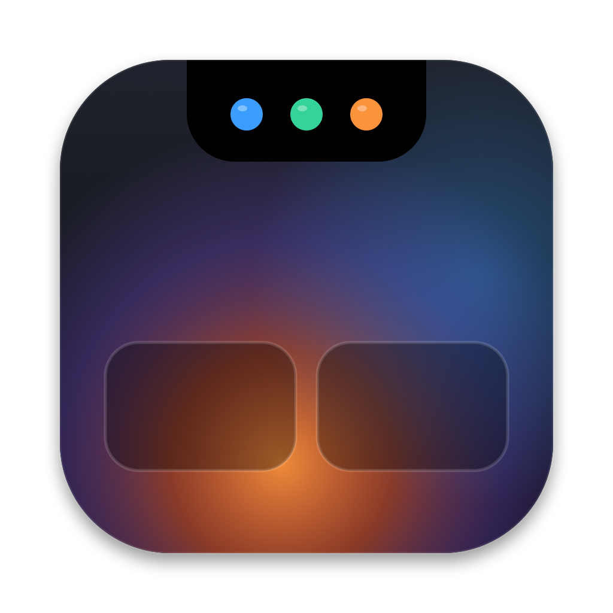
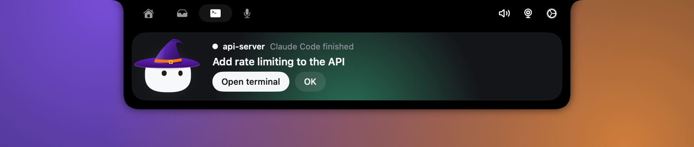
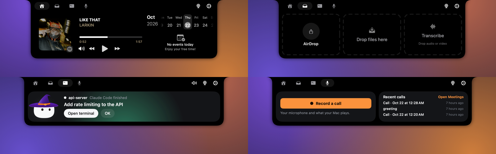
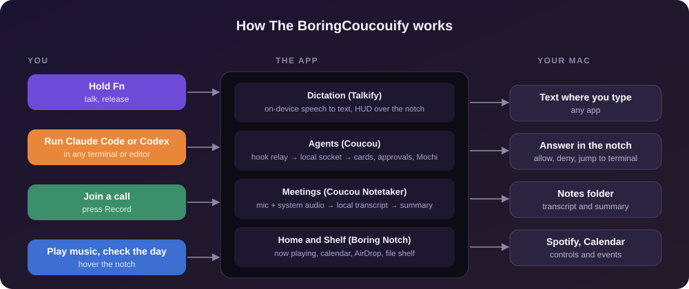

<h1 align="center">
  <br>
  
  <br>
  The BoringCoucouify
  <br>
</h1>

<p align="center"><b>Your Mac's notch, doing everything: music, agents, dictation and meetings.</b></p>

<p align="center">
  
  
  
  
</p>

<p align="center">
  
</p>

One menu-bar-free app that lives in the notch and brings three open-source projects together: [Boring Notch](https://github.com/TheBoredTeam/boring.notch) for music, calendar and a file shelf, [Coucou](https://github.com/Louis-CFM/coucou) for coding agents and a call recorder, and [Talkify](https://github.com/tornikegomareli/Talkify) for hold-Fn dictation. Four tabs at the top switch between them. When the notch is closed, music shows on the left and the agent's Mochi on the right; hover the left half to open Home, the right half to open Agents.

> **Status: personal build.** It runs daily on one Mac. There are no releases, no notarized downloads and no updates yet; you build it yourself (below). Expect rough edges, and see [Licensing](#licensing) before sharing it.

## What's in it

| | |
| --- | --- |
| **Home** | Now playing with controls (Spotify, Apple Music), a calendar with your events, a camera mirror, and the usual volume, brightness and battery HUDs |
| **Shelf** | Three panels: AirDrop and share on the left, a file shelf in the middle, and drop-to-transcribe on the right |
| **Agents** | Live cards for Claude Code, Codex, Gemini CLI, Cursor and more. Approve or deny permission requests and answer questions from the notch, jump to the terminal, mute with one key. Mochi reacts to your pointer |
| **Meetings** | One press records your microphone and what your Mac plays, transcribes it on device, and writes a summary into your notes folder |
| **Dictation** | Hold Fn and talk; the words are typed where your cursor is. Read-aloud, a HUD that takes over the notch while it works, and a keyboard board for changing every shortcut |

## See it

<p align="center">
  
</p>

<p align="center"><i>Home, Shelf, Agents and Meetings.</i></p>

## How it works

<p align="center">
  
</p>

Coucou's hook relay (`nb-hook`) sends each agent event to a local unix socket the app listens on, which is what drives the Agents tab. Speech to text runs on device (Parakeet for meetings and Talkify's own engine for dictation), so audio does not leave the Mac.

## Build and install

You need macOS 26 or later, Xcode, and the Metal Toolchain (`xcodebuild -downloadComponent MetalToolchain`).

```bash
git clone https://github.com/serjdmitri/TheBoringCoucouify.git
cd TheBoringCoucouify
scripts/install.sh              # Release build, sign, copy to /Applications, launch
```

That produces `/Applications/The BoringCoucouify.app`. Use `scripts/install.sh --no-launch` to install without starting it. Speech models (about 650 MB) download the first time you use Meetings or Dictation.

### Sign it once, so permissions stick

macOS ties Accessibility and Input Monitoring to the app's code signature, and an ad hoc signature changes on every build. Create a local self-signed certificate named `TheBoringCoucouify Local Signing` once ([step by step](docs/SIGNING.md)); `install.sh` finds it and every later install keeps your permissions. Without it the app still works, but you grant those permissions again after each install.

On first launch it asks for Accessibility and Input Monitoring (Fn dictation and global shortcuts), Microphone and audio capture (dictation and the call recorder), and Calendar. If Fn stops working after a reinstall, run `tccutil reset Accessibility` and grant it again.

## Using it

| To | Do this |
| --- | --- |
| Open Home or Agents | Hover the left or right half of the notch, or press ⌘⇧I |
| Dictate | Hold **Fn**, talk, release |
| Change any shortcut | Settings → Dictation, then the keyboard board |
| Open or close Agents | ⌘⇧N (off by default; switch it on in Settings → Agents → Shortcuts) |
| Jump to an agent's alert | ⌃⌥A |
| Jump to its terminal | ⌃⌥T |
| Next or previous agent | ⌃⌥] and ⌃⌥[ |
| Mute Mochi | ⌃⌥M |
| Record a call | Meetings tab → **Record a call** |
| Transcribe a file | Drop audio or video on the Shelf's right panel |
| Hide agent pills sooner or later | Settings → Agents → General → Hide after N min (default 3) |

Hooks for Claude Code usually work straight away. Codex, Gemini CLI, Cursor and others are installed from Settings → Agents, which shows the exact file change for you to confirm first.

## Repository layout

| Path | What |
| --- | --- |
| `boringNotch/` | The app target: Boring Notch plus the changes that join the three |
| `boringNotch/Talkify/` | Talkify's sources, compiled into the app |
| `Packages/CoucouCore/` | Coucou as a local Swift package, with the glue (`CoucouHost`, `AgentsTabView`, `MeetingsTabView`) |
| `Packages/CoucouCore/PATCHES.md` | Every change made to Coucou's own files |
| `UPSTREAM.md` | The upstream commit each part was taken from |
| `scripts/` | `install.sh`, plus the generators for the app icon and these README images |
| `docs/` | Signing guide, images, and the original Boring Notch README |

For contributors: the Xcode project lists files explicitly, so a new file is added to `project.pbxproj` (except inside `boringNotch/Talkify`). Talkify builds in Swift 5 mode inside the app target; Coucou is a Swift 6 package. Talkify's entry point is replaced by `TalkifyRuntime`, its Sparkle updater is never started, and the app is not sandboxed.

## Credits

Built on the work of the three projects above: **Boring Notch** by the Boring.Notch team (base app, GPL-3.0), **Coucou** by Louis-CFM (agents, Mochi and the call recorder, MIT), and **Talkify** by Tornike Gomareli (dictation, MIT).

## Licensing

The combined app is GPL-3.0 because Boring Notch is (see [LICENSE](LICENSE)); the other licenses are in [licenses/](licenses). Not everything is free to redistribute: Coucou's name, the Mochi character and its sounds are not MIT ([details](licenses/Coucou/LICENSE-ASSETS.md)), Talkify's Pop sounds are CC-BY-NC, and one Siri-style image in Talkify has no license. That is fine for personal use and has to be sorted out before any public release.
