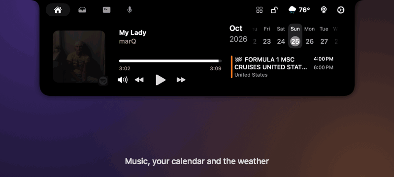

<p align="center">
  
</p>

<h1 align="center">Tuckr</h1>

<p align="center"><b>Everything you reach for, tucked into your Mac's notch.<br>Music, your calendar, AI coding agents, messages, calls, dictation and file tools, in the space your Mac was wasting.</b></p>

<p align="center">
  Tuckr turns the notch into a small control center. Move the pointer to it and it opens: what's playing, your day, your agents' progress and permission requests, the message that just arrived, a file you want to share, resize or transcribe. Move away and it's gone. Free, open source, nothing leaves your Mac.
</p>

<p align="center">
  <a href="https://github.com/serjdmitri/Tuckr/releases/latest"></a>
  
  
  
  
  <a href="LICENSE"></a>
  <a href="https://github.com/serjdmitri/Tuckr/stargazers"></a>
</p>

<p align="center">
  <a href="https://github.com/serjdmitri/Tuckr/releases"></a>
  
  
  
  
</p>

<p align="center">
  <a href="https://github.com/serjdmitri/Tuckr/releases/latest"><b>Download for macOS</b></a> ·
  <a href="#download">Install</a> ·
  <a href="#privacy">Privacy</a> ·
  <a href="CREDITS.md">Credits</a>
</p>

<p align="center">
  
</p>

> **Status: beta.** It runs daily on one Mac and has not been tested on many others yet. Releases are not notarized by Apple, so macOS asks you to confirm the first launch ([how](#download)). After that, updates arrive by themselves. See [Licensing](#licensing) for what is and is not free to reuse.

Tuckr brings three open-source projects together: [Boring Notch](https://github.com/TheBoredTeam/boring.notch) for music, calendar and a file shelf, [Coucou](https://github.com/Louis-CFM/coucou) for coding agents and a call recorder, and [Talkify](https://github.com/tornikegomareli/Talkify) for hold-Fn dictation, plus a lot that is new: messages and calls in the notch, Transform, a month calendar, the weather, a timer, notes and a teleprompter. When the notch is closed, music shows on the left and the agent's Mochi on the right; point at the middle for Home, at a side to open what is going on there.

## What's in it

| | |
| --- | --- |
| **Home** | Now playing with controls (Spotify, Apple Music), a calendar (tap the month to see the whole month, with a mark under each busy day), the weather, a camera mirror, and the usual volume, brightness and battery HUDs |
| **Shelf** | Drag a file at the notch: AirDrop and share, a file shelf, drop-to-transcribe (Russian and 24 other languages), and **Transform** (resize, compress, convert, rotate, cut out the background, clean metadata, make a PDF, zip) |
| **Agents** | Live cards for Claude Code, Codex, Gemini CLI, Cursor and more. Approve or deny permission requests and answer questions from the notch, jump to the terminal, mute with one key. Mochi reacts to your pointer and to what happens on your Mac. Double-click the tab for a chat with Mochi, right-click it for his quick settings |
| **Messages and calls** | Popups for new Messages, WhatsApp, Telegram, Slack and Mail notifications with a quick reply and voice playback, and Answer / Decline for incoming FaceTime, phone and WhatsApp calls. A switch replaces macOS's own banners |
| **Tools** | Timer, Notes (your Apple Notes), a Teleprompter you can scroll while it runs, and popups for AirPods, downloads, AirDrop, Focus and your next event |
| **Meetings** | One press records your microphone and what your Mac plays, transcribes it on device, and writes a summary into your notes folder |
| **Dictation** | Hold Fn and talk; the words are typed where your cursor is. Read-aloud, a HUD that takes over the notch while it works, and a keyboard board for changing every shortcut |

## See it

<p align="center">
  
</p>

<p align="center"><i>Home, Shelf, Agents and Meetings.</i></p>

## How it works

<p align="center">
  
</p>

Coucou's hook relay (`nb-hook`) sends each agent event to a local unix socket the app listens on, which is what drives the Agents tab. Speech to text runs on device (Parakeet for meetings and Talkify's own engine for dictation), so audio does not leave the Mac.

## Download

1. Get **`Tuckr-x.y.z.dmg`** from the [latest release](https://github.com/serjdmitri/Tuckr/releases/latest) (Apple silicon Mac, macOS 26 or later).
2. Open it and drag **Tuckr** into **Applications**.
3. The first time, **right-click Tuckr → Open → Open** (the app is not notarized by Apple). If macOS still refuses: `xattr -dr com.apple.quarantine /Applications/Tuckr.app`.
4. Follow the welcome screen; it explains each permission and asks for them one by one.

Updates are checked about once a day and installed only when you say yes (**Settings → About → Check for Updates…** looks right now). Every update is signed with the author's key, and the app refuses anything that is not ([how it works](docs/UPDATES.md)).

## Build and install

You need macOS 26 or later, Xcode, and the Metal Toolchain (`xcodebuild -downloadComponent MetalToolchain`).

```bash
git clone https://github.com/serjdmitri/Tuckr.git
cd Tuckr
scripts/install.sh              # Release build, sign, copy to /Applications, launch
```

That produces `/Applications/Tuckr.app`. Use `scripts/install.sh --no-launch` to install without starting it. Speech models (about 650 MB) download the first time you use Meetings or Dictation.

### Sign it once, so permissions stick

macOS ties Accessibility and Input Monitoring to the app's code signature, and an ad hoc signature changes on every build. Create a local self-signed certificate named `TheBoringCoucouify Local Signing` once ([step by step](docs/SIGNING.md)); `install.sh` finds it and every later install keeps your permissions. Without it the app still works, but you grant those permissions again after each install.

On first launch it asks for Accessibility and Input Monitoring (Fn dictation and global shortcuts), Microphone and audio capture (dictation and the call recorder), and Calendar. If Fn stops working after a reinstall, run `tccutil reset Accessibility` and grant it again.

## Using it

| To | Do this |
| --- | --- |
| Open Home or Agents | Hover the left or right half of the notch, or press ⌘⇧I |
| Dictate | Hold **Fn**, talk, release |
| Change any shortcut | Settings → Dictation, then the keyboard board |
| Open or close Agents | ⌘⇧N (off by default; switch it on in Settings → Agents → Shortcuts) |
| Jump to an agent's alert | ⌃⌥A |
| Jump to its terminal | ⌃⌥T |
| Next or previous agent | ⌃⌥] and ⌃⌥[ |
| Mute Mochi | ⌃⌥M |
| Record a call | Meetings tab → **Record a call** |
| Transcribe a file | Drop audio or video on the Shelf's right panel |
| Hide agent pills sooner or later | Settings → Agents → General → Hide after N min (default 3) |

Hooks for Claude Code usually work straight away. Codex, Gemini CLI, Cursor and others are installed from Settings → Agents, which shows the exact file change for you to confirm first.

## Repository layout

| Path | What |
| --- | --- |
| `boringNotch/` | The app target: Boring Notch plus the changes that join the three |
| `boringNotch/Talkify/` | Talkify's sources, compiled into the app |
| `Packages/CoucouCore/` | Coucou as a local Swift package, with the glue (`CoucouHost`, `AgentsTabView`, `MeetingsTabView`) |
| `Packages/CoucouCore/PATCHES.md` | Every change made to Coucou's own files |
| `UPSTREAM.md` | The upstream commit each part was taken from |
| `scripts/` | `install.sh`, plus the generators for the app icon and these README images |
| `docs/` | Signing guide, images, and the original Boring Notch README |

For contributors: the Xcode project lists files explicitly, so a new file is added to `project.pbxproj` (except inside `boringNotch/Talkify`). Talkify builds in Swift 5 mode inside the app target; Coucou is a Swift 6 package. Talkify's entry point is replaced by `TalkifyRuntime`, its Sparkle updater is never started, and the app is not sandboxed.

## Credits

Tuckr is made from three open-source projects, **Boring Notch** (The Boring Team, GPL-3.0), **Coucou** (Louis Raillé, MIT) and **Talkify** (Tornike Gomareli, MIT), and uses many libraries and a few online services. Everyone and everything is listed, with licences, in [CREDITS.md](CREDITS.md).

## Privacy

- **Stays on your Mac:** messages shown in the notch (read from macOS's notification list and, in instant mode, from Messages' and WhatsApp's own databases, read-only and never saved), dictation and file transcription (on-device models), notes, teleprompter scripts (a private folder only you can read), Mochi's agent events (a local socket only your account can use).
- **Passwords and API keys** go in the macOS Keychain (this device only, never synced), never in a file or a setting.
- **Network:** weather (Open-Meteo, and ipwho.is to find your city), lyrics (LRCLIB gets the song and artist), Sparkle's update check, and, only if you switch them on, the AI and service accounts you add in Agents Settings. Plain-HTTP is allowed to your own network only.
- **Permissions** are asked for one by one in the welcome screen with what each is for. Full Disk Access is only used to read the notification list.

## No warranty

Tuckr is provided as it is, without any warranty, as the GPL-3.0 says (sections 15 and 16). It reads the notifications and messages on your own Mac (and the other things listed under Privacy) to show them in the notch; nothing leaves your Mac except what is listed there. You use it at your own risk.

## Licensing

Tuckr as a whole is **GPL-3.0** (see [LICENSE](LICENSE)), because Boring Notch is. In plain words: you may use, change and share it, as long as what you share is also GPL-3.0 and comes with its source.

The files written for Tuckr itself (the features in `boringNotch/Extras`, the scripts, the docs and the icon) are **also available under the MIT licence** ([LICENSE-MIT](LICENSE-MIT) lists exactly which), so you can lift them out and use them in your own project. Everything else keeps its own licence: nobody can relicense Boring Notch, Talkify, Coucou or the libraries, and the whole app cannot be MIT.

Not everything in the repository is free to redistribute: the names "Coucou" and "Mochi", the Mochi character, its sounds and icon belong to their author ([details](licenses/Coucou/LICENSE-ASSETS.md)), and one of Talkify's sound effects ("Plunger pop", CC-BY-NC) may only be used non-commercially. The Siri-style dictation orb uses images with no licence. All of that is fine for personal use and has to be sorted out before any wider release.
